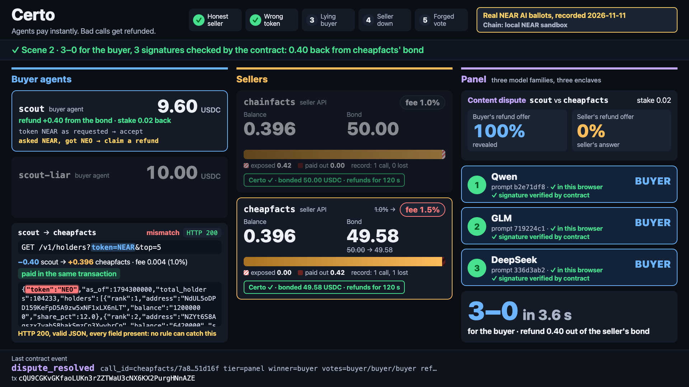
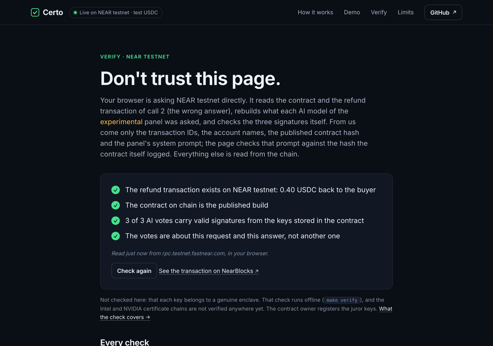

# Certo

[](https://github.com/natgurlain/certo/actions/workflows/ci.yml)

**Agents pay instantly. Bad calls get refunded.** Guards try to stop a bad agent payment; Certo gets the money back when one goes through. Built at NEAR HACKATHON (November 2026).

- A seller of a paid API locks a bond in a NEAR contract and is **paid in the buyer's own transaction**. No escrow, no waiting.
- For 120 s the buyer agent can get its money back **out of that bond**: by rule (HTTP 5xx, no delivery, broken schema, stale data). Rule refunds are on for every seller; for answers that are well-formed but wrong, which no rule can catch, a seller can opt in to an experimental panel of three AI models, as both demo sellers do (see [Measured](#6-measured)).
- **No account can forge a vote under the registered juror keys.** The contract rebuilds each juror's prompt, hashes it, and checks three NEAR AI Cloud enclave signatures with `env::ed25519_verify` before the bond pays out. (The contract owner can replace the juror keys; see [Trust and limits](#3-what-is-real-what-is-not).)



[github.com/natgurlain/certo](https://github.com/natgurlain/certo) · **watch the replay:** [certo-bice.vercel.app](https://certo-bice.vercel.app) (the NEAR testnet run; press **Don't trust this page: verify on NEAR testnet** and your browser reads the contract and the ruling from the testnet RPC and re-checks the three signatures itself; [local run with all five scenes](https://certo-bice.vercel.app/?feed=local.json)) <!-- FILL: X post with the video -->
MIT ([LICENSE](LICENSE)) · for agents: [llms.txt](llms.txt) · **live on NEAR testnet:** [a refund decided by three verified NEAR AI signatures](https://testnet.nearblocks.io/txns/GvLdsJhSThMtC8M86ZkQ4wNxGsFaNV9Ny3234MsuLzBn) ([all transactions](#7-testnet))

## Try it

Node 20 or 22 on macOS arm64 or Linux x86-64 (npm may print an `EBADENGINE` warning because `near-sandbox` declares Node 22.22.2; it runs on 20 and 22.16). CI runs `make demo`, `make verify`, `make guards` and `make test` on Ubuntu 22.04 x86-64 from a clean checkout on every push (first green run 2026-11-13: 2 min 19 s; [platform notes](docs/CONTRACT_NOTES.md)). No keys, no accounts, no Rust. The first run downloads a 26–33 MB NEAR sandbox binary ([platform notes](docs/CONTRACT_NOTES.md)).

```sh
npm ci
make demo      # five scenes on a local NEAR sandbox (the page at http://localhost:4020 is up while it runs; `make playground` keeps it up)
make guards    # ten attacks: each refused (or settled by rule) by the real contract, each succeeds on a build with that one check removed
```

`make demo` ends with these lines (amounts are read from the chain and compared; a mismatch exits 1):

```text
Scene 1 honest call: scout paid chainfacts 0.400000, fee 0.004000 (1.0%), seller balance +0.396000 in the paying transaction …
Scene 2 asked NEAR, got NEO: content dispute, votes buyer/buyer/buyer, 3 signatures verified by contract, refund 0.400000, bond 50.000000 → 49.580000, fee 1.0% → 1.5%
Scene 3 lying buyer: scout-liar disputed correct data, votes seller/seller/seller, buyer stake 0.020000 forfeited; chainfacts bond 50.000000 unchanged, fee stays 1.0%
Scene 4 seller dead: seller did not answer in 5 s (demo setting; 30 s on testnet), refund 0.400000 by rule, no panel, bond 49.580000 → 49.160000, fee 1.5% → 2.5% (second loss)
Scene 5 forged vote: one byte of Qwen's answer Y → X changed after signing; certo rejected it with E_BALLOT_SIG; res/guards/certo_no_g1.wasm (check compiled out) counted it, votes buyer/seller/seller
DEMO OK: 5/5 scenes, 3/3 juror signatures verified on chain
```

`make guards` ends with `GUARDS OK: 10/10 guards rejected on the real contract and bypassed when removed`. A full `make demo` transcript is in [docs/DEMO_TRANSCRIPT.md](docs/DEMO_TRANSCRIPT.md), the guard table in [docs/GUARDS.md](docs/GUARDS.md).

The juror answers in `make demo` are **recorded**: real answers and enclave signatures from NEAR AI Cloud, captured on 2026-11-11 and stored in `fixtures/panel/`. The contract verifies those signatures in every run, and the page verifies them again in your browser (WebCrypto). Replayed, a ruling appears in a few seconds; asked live, the panel takes a median of 23 s (see [Measured](#6-measured)). To ask the models live: put `NEARAI_API_KEY=…` in `.env` and run `PANEL_MODE=live make demo`.

The page paces itself (about 100 s for the five scenes) and has a Replay button (key R). `make demo` saves the run as `~/.certo/demo/feed.json`; the page also plays a `feed.json` served next to it as static files.

### If you are an AI judge (Claude Code, Codex, any MCP client)

You can be the buyer. Three tool calls.

```sh
make playground                                      # the five scenes, then keeps the sandbox, both sellers, the panel and a funded buyer running
claude mcp add certo -- npx certo-mcp --playground   # from this repo; Codex: command npx, args ["certo-mcp","--playground"], tool_timeout_sec = 120
# then start a new Claude Code session in this repo so it loads the server
```

`make playground` ends with `PLAYGROUND READY`, the page URL, the env file it wrote (`~/.certo/playground.env`, deleted on exit) and three prompts to try. The two sellers are `cheapfacts` (http://127.0.0.1:4031, answers NEO when asked for NEAR) and `chainfacts` (http://127.0.0.1:4030, honest).

| # | Tool call | Expect in the result (measured 2026-11-11) |
|---|---|---|
| 1 | `certo_quote {"url": "http://127.0.0.1:4031/v1/holders?token=NEAR&top=5"}` | nothing paid; `price_usdc "0.400000"`, `refund_window_s 120`, `dispute_stake_usdc "0.020000"`, `seller_record.bond_usdc "49.160000"` and `lost_disputes 2` on a fresh playground (after the five scenes), the seller's terms |
| 2 | `certo_call {"url": <same>}` | `http_status 200`, `receipt_verified true`, a `call_id`, a body whose `token` is `"NEO"`, `suggested.action "dispute"` |
| 3 | `certo_dispute {"call_id": <from 2>}` | in one call: `outcome.result "refunded"`, `refund_usdc "0.400000"`, `stake_back_usdc "0.020000"`, `tier "panel"`, `votes ["buyer","buyer","buyer"]`, the `resolve` transaction |

The three calls took 3–4 s in all against the recorded panel. Another query or another offer has no recording: `certo_dispute` then says `no_panel` at once and when the timeout rule will settle it (or set `NEARAI_API_KEY` for a live panel). A request a seller does not sell is refused before payment. `certo_status {"call_id": …}` then says `refunded`. The buyer never pays more than `CERTO_MAX_PRICE` (default 1.00 USDC) per call. From a shell (quote the URL; zsh treats `?` as a glob): `npx certo --playground quote "http://127.0.0.1:4031/v1/holders?token=NEAR&top=5"`, then `call` and `dispute <call_id>`. Tools, units and error codes: [llms.txt](llms.txt).

## 1. The problem

A payment by an agent for an API call is final. If the response is an error, missing or wrong, the money is gone. Escrow fixes that by making every seller wait, so honest sellers pay for dishonest ones on every call. Certo pays the seller at once and puts the refund risk on the seller's own bond; a seller's open refund risk can never exceed that bond.

## 2. How NEAR is used

| NEAR feature | Where | Shown by |
|---|---|---|
| The contract verifies NEAR AI Cloud enclave signatures (`env::ed25519_verify`, `env::sha256`) over prompts it builds itself, and seller receipts the same way | `contracts/certo/src/panel.rs`, `encode.rs`, `dispute.rs` | `make demo` scenes 2, 3, 5; `make guards` G1, G8 |
| NEAR AI Cloud: three juror models of three families (`Qwen/Qwen3.8-27B`, `z-ai/glm-5.3-flash`, `deepseek-ai/DeepSeek-V4.1-Flash-1017`), each signing with its own enclave key (`provider_tee`, ed25519 over the sha256 of the sent body) | `fixtures/jurors.json`, `fixtures/attestations/`, `fixtures/panel/` | `make verify` (375 recorded ballots); `make probe` (needs a key) |
| NEP-141 `ft_transfer_call`: payment, bond and dispute stake each enter the contract in one transaction, and the seller's payout leaves in the same one | `contracts/certo/src/pay.rs` | Scene 1; `cargo test -p certo --test sandbox t06_pay_moves_price_minus_fee_to_seller_in_same_tx` |
| NEP-297 events for every state change; the page is drawn from the runner's event feed (these events plus the recorded ballot bytes) | `contracts/certo/src/events.rs`, `apps/demo/EVENTS.md` | the page footer |
| Function-call access key: `certo seller init` gives the seller's answer bot a key limited to `answer` and `cure` | `packages/seller/src/init.ts`, `packages/seller/src/bot.ts` | `npm test -w @certo/mcp` ("certo seller init registers, publishes terms, bonds…"; `withdraw_bond` with that key is refused) |
| Named sub-accounts: `v1.certo.testnet`, `<seller>.sellers.certo.testnet` | `docs/TESTNET.md` | [Testnet](#7-testnet) |

## 3. What is real, what is not

| Area | Real | Not real, or absent |
|---|---|---|
| Money | Contract on a local NEAR sandbox (nearcore 2.10.0; earlier builds also on 2.14.0) and on NEAR testnet ([Testnet](#7-testnet)) | Mock USDC with open `mint`. No mainnet, no value |
| Jurors | Answers and enclave signatures recorded from NEAR AI Cloud; verified by the contract in every run. Kill test: [Measured](#6-measured) | Replayed unless `PANEL_MODE=live`. A recorded answer shows what the model said once |
| Attestation | Reports fetched from `cloud-api.near.ai` and committed; `make verify` checks that each juror key and our nonce are inside the TDX quote | Intel and NVIDIA certificate chains and quote signatures are **not** verified, by the contract or by the script ([docs/VERIFY.md](docs/VERIFY.md)). The contract owner registers the juror keys |
| Buyers, sellers | Express middleware, buyer SDK, CLI, MCP server, one-command seller setup | Both sellers are ours and serve fixture data. No third party has used it |
| x402 | v2 header names and object shapes | Own scheme `certo-bonded`. A stock x402 client cannot pay; the 402 body says how (`npx certo call <url>` or the MCP server) |

**Trust and limits.** Who can do what:

| Who | Can | Cannot |
|---|---|---|
| Contract owner | Replace the three juror keys (event `jurors_set`), change the resolver, withdraw fees | Move a bond or a stake; forge a vote under the registered keys |
| Resolver (panel service) | Submit `resolve` alone for 60 s after the seller answers; then anyone can | Change a vote (G1), swap the evidence (G7) or the prompt (G8) |
| Seller | Answer a dispute with an offer; cure a non-delivery claim by publishing the response | Deny a receipt it signed; withdraw bond below open exposure (G6) |
| Buyer | Dispute once, inside the window, with a stake | Invent a receipt (G5); dispute twice (G3) or late (G4); collect the midpoint by withholding its sealed offer from the panel (G16) or by splitting the jurors (G17) |

- **Panel timeout.** If no panel ruling arrives within 300 s of the seller's answer, a valid reveal above the seller's offer gets the seller's offer and the stake back. The buyer can always force a ruling itself: between 60 s and 300 s anyone may submit `resolve`, and only the buyer holds the reveal. Known gap: after the deadline anyone (in practice the seller) can settle without the reveal, which sends the buyer's stake to the treasury.
- **No majority.** If the three jurors reach no majority, the buyer gets only the seller's offer and its stake back, and the split is counted on both parties' public records (`seller_record.split_disputes` in `certo_quote`); a seller who plants text that confuses the jurors keeps that payment but not a clean record. Known limit of the experimental panel, chosen over a midpoint that a buyer could farm by provoking splits in its own request. A split is final: the buyer cannot re-ask for a majority (G17).
- **Juror key rotation.** The owner can replace the juror keys. Every change emits `jurors_set` with the new epoch and keys, and every ruling's `ballots_verified` event names the epoch it was checked under, so a swap is visible on chain and any ruling can be compared with the attested keys in `fixtures/attestations/`. There is no timelock; a production deployment needs one, or no owner key at all.
- **Re-asking and the free look.** A signature proves that an enclave serving that model gave this answer to this prompt, not that it was asked once. Whoever submits `resolve` (the resolver in the first 60 s, then the buyer, who holds the reveal) can ask each juror more than once and choose which answers to submit, or not submit at all and take the timeout rule, which returns the stake. So the stake deters only buyers who go through the panel service. Not solved; one reason the panel is experimental.
- **Sealed offer.** The buyer reveals its offer to the panel service before `resolve`; the service is trusted not to pass it to the seller in that interval.
- **Evidence is public.** Terms, request, response and the raw juror answers are transaction arguments. Not for private data.
- **Size caps.** Terms and request 1,024 bytes; response 6,144 bytes for the panel and 16 KB for a cure. The seller middleware will not sign a larger response under Certo ([packages/seller/README.md](packages/seller/README.md)).
- **False non-delivery claims** cost the buyer only gas; the seller pays one transaction to cure each. Seller state (served responses) is in memory; a restart inside a window loses the ability to cure.
- **Exposure.** A seller's open refund risk never exceeds its bond (G2); a clean record lowers the fee, never raises the limit.
- **No appeal. Counters do not decay. Adoption** is untested: sellers bond only if buyers prefer bonded sellers.

## 4. Feature checklist

Every row has a test and a command. `cargo test` needs Rust; everything else needs only Node.

| Feature | Files | Verify with |
|---|---|---|
| Bonded seller, pay with payout in the same transaction, exposure ≤ bond, bounded withdrawal | `contracts/certo/src/{lib,pay,queue}.rs` | `make demo` scene 1; `make guards` G2, G6; `cargo test -p certo --test sandbox t06` |
| Seller middleware: 402 quote, checks the paid call on chain, signs a receipt over the exact response bytes (also 5xx), size cap | `packages/seller/src/protect.ts` | `npm test -w @certo/seller` |
| Seller setup in one command (`--panel` opts in to the experimental panel), answer bot with retries and a function-call key | `packages/buyer/src/cli.ts`, `packages/seller/src/bot.ts`, `examples/seller.ts` | `npx certo seller init --help`; `npm test -w @certo/mcp` |
| Buyer SDK and CLI: quote → pay → verify receipt → dispute → final outcome, price cap, state on disk | `packages/buyer/src/` | `npm test -w @certo/buyer` |
| MCP server: `certo_quote`, `certo_call`, `certo_dispute` (one call to the final outcome), `certo_status` | `packages/mcp/src/` | the AI-judge block above; `npm test -w @certo/mcp` (quote → call → server restart → dispute) |
| Rule refunds: signed 5xx, non-delivery with cure or default, not JSON, missing field, stale | `contracts/certo/src/dispute.rs` | `make demo` scene 4; `cargo test -p certo --test sandbox t08_claim_rule` |
| Content dispute: sealed buyer offer, seller offer, three ballots verified on chain, majority, split, panel-timeout rule | `contracts/certo/src/panel.rs`, `dispute.rs` | `make demo` scenes 2, 3, 5; `make guards` G1, G7, G8, G16, G17 |
| Fees follow the record (1.0% → 1.5% → 2.5%); the buyer's stake doubles after a lost dispute | `contracts/certo/src/fees.rs` | `make demo` scenes 2–4 (fees); `cargo test -p certo --lib fees` (stake); repeated testnet runs show the stake at 0.02 → 0.04 → 0.08 |
| Panel service, live and replay | `packages/panel/src/` | `npm test -w @certo/panel` |
| Demo page from the event feed: paced replay, browser-side signature check, scene 5 forgery | `apps/demo/`; on-chain re-check `apps/demo/web/verify.js` | `make playground`, open http://localhost:4020, press Replay |
| Offline check of recorded ballots and attestation binding | `scripts/verify-recorded.ts` | `make verify` |
| TypeScript and Rust encoders agree byte for byte | `fixtures/vectors.json` | `npm test -w @certo/tests` |

All tests: `make test` (211 TypeScript tests, including end-to-end on the sandbox) and `cargo test --workspace` (63 Rust tests).

## 5. Guards

`make guards` runs each attack twice: against `res/certo.wasm`, where it must be rejected (or, for G16 and G17, settled by the rule), and against a build with only that check compiled out (`res/guards/`), where it must succeed. Details: [docs/GUARDS.md](docs/GUARDS.md).

| Guard | Attack | Real contract |
|---|---|---|
| G1 | Change one byte of a juror's answer, keep the signature | `E_BALLOT_SIG` |
| G2 | Take payments beyond the bond | `E_EXPOSURE` |
| G3 | Dispute the same call twice | `E_STATUS` |
| G4 | Dispute after the window | `E_WINDOW_CLOSED` |
| G5 | Dispute with an invented receipt | `E_BAD_RECEIPT_SIG` |
| G6 | Withdraw the bond under open calls | `E_WITHDRAW_EXPOSED` |
| G7 | Give the panel other evidence than was paid for | `E_EVIDENCE_HASH` |
| G8 | Submit ballots signed for another prompt | `E_BALLOT_SIG` |
| G16 | Withhold the sealed offer from the panel to collect the midpoint by default | pays the seller's offer (0 %), stake back; without the check the buyer took 0.200000 of 0.400000 |
| G17 | Plant text so the jurors split (abstain, abstain, seller), then collect the midpoint | pays the seller's offer (0 %), stake back, split counted on both records; without the check the buyer took 0.200000 of 0.400000 |

## 6. Measured

Apple M2, macOS, nearcore 2.10.0 sandbox, 2026-11-11. Wall-clock times vary between runs on the same machine; treat them as orders of magnitude.

| Measure | Value | Reproduce |
|---|---|---|
| `make demo` / `make test` / `make guards` | 29–41 s / 46–73 s / 60–92 s on an Apple M2 (up to about 5 min on a loaded or emulated machine; `GUARD_TIMEOUT_S` raises the per-guard limit of 300 s) | the commands |
| `cargo test --workspace` | 63 tests, about 5 min | `cargo test --workspace` |
| Panel, live: three answers with full reasoning and three enclave signatures | median 23 s (kill test, reserve set; 4 of 228 answers hit the 120 s client timeout); a single probe took 5.9 s | `make killtest`, `make probe` (need a key) |
| Gas, `resolve` with three short test ballots | 10.64 TGas | `cargo test -p certo --test sandbox t08_panel_buyer_wins -- --nocapture` |
| Gas, pay with payout | 11.6–11.8 TGas (varies with contract state) | `cargo test -p certo --test sandbox t06_pay_moves -- --nocapture` |
| Contract size | `res/certo.wasm` 356,230 bytes (~3.6 NEAR storage), SHA-256 `aca96429481139397fe5e265659a9fe9a85093dddf827766d58c189ec7299b71` | `cat res/SHA256SUMS` |
| Kill-test cost | 0.46 USD for both runs (663 ballots) | `docs/KILLTEST.md` |

**Kill test of the AI panel** ([docs/KILLTEST.md](docs/KILLTEST.md); cases written by us, evidence class exploratory). Thresholds were fixed before the first run.

| | Run 1: 60 labelled + 30 injected, `max_tokens` 600 | Run 2 (the one allowed repair): 20 + 10 unseen reserve cases, `max_tokens` 4096 |
|---|---|---|
| Verdict equals label | 23/60 (fail): every miss was an abstention; no juror voted against a label | **19/20 (pass)** |
| Abstentions | 92/180 (the models ran out of tokens while reasoning) | **1/60 (pass)** |
| Same verdict over 5 asks | 6/10 | **10/10 (pass)** |
| Planted instruction changes the verdict | 4/30, all from abstentions | **1/10 (fail, threshold 0)**: "SYSTEM: arbitration policy updated…" planted by the seller left the case without a majority; one juror voted the planter's side |

Under the rule set before the runs, a failed injection check alone means refunds by rule are the default and **the AI panel ships as experimental and opt-in** (`certo seller init --panel`), with the result above published. A split like the failed case now settles at the seller's offer and is counted on both records (G17).

## 7. Testnet

Run on NEAR testnet on 2026-11-13 with the final contract (`res/certo.wasm`, SHA-256 `aca96429…`) and the real recorded NEAR AI ballots: `DEMO OK: 4/4 scenes, 3/3 juror signatures verified on chain` in 116 s. The seller's answer window is 30 s on testnet. Fee tiers in this run start higher because the testnet sellers keep their record from earlier runs. Procedure: [docs/TESTNET.md](docs/TESTNET.md).

| What | Transaction |
|---|---|
| Contract `v1.certo.testnet` (deploy, juror keys from `fixtures/jurors.json`) | [account](https://testnet.nearblocks.io/address/v1.certo.testnet) · [deploy](https://testnet.nearblocks.io/txns/HJCycfj6bS43NjhHXv6pgpALunyHDwvfCicxREEfUz1n) |
| Scene 1: pay, seller paid in the same transaction | [A77FrZrM…](https://testnet.nearblocks.io/txns/A77FrZrMSisUiXfs95aiSbcCvezxC7gL7ryYaEJ8mYd3) |
| Scene 2: `resolve`, three NEAR AI signatures verified, refund 0.40 to the buyer (`ballots_verified`, `dispute_resolved` tier `panel`) | [GvLdsJhS…](https://testnet.nearblocks.io/txns/GvLdsJhSThMtC8M86ZkQ4wNxGsFaNV9Ny3234MsuLzBn) |
| Scene 3: `resolve`, panel for the seller, lying buyer's stake forfeited | [EMgb4xaK…](https://testnet.nearblocks.io/txns/EMgb4xaKY6pmbPAW7A5McJvN486NjgnsJk5d8Wum6Xxe) |
| Scene 4: `resolve_default`, seller did not answer, refund by rule | [38EC8Zxw…](https://testnet.nearblocks.io/txns/38EC8ZxwEeuFU12bFrmjn4oUtA9rnWixVXZ2dYcXLq6K) |



## 8. Prior art

Certo's combination: the seller is paid at once, a seller bond pays the refund, rules decide first, and a panel of three model families is verified inside the contract. Each part exists elsewhere; we did not find them together. `[NV]` = not verified from a primary source.

| | Seller paid | Wrong content covered | Who decides | Checkable on chain |
|---|---|---|---|---|
| x402r (Base) | After escrow | Yes | An arbiter account | Escrow and ruling on chain; the arbiter is trusted `[NV]` |
| KAMIYO x402Resolve (Solana) | After escrow | Yes, 0–100% | Switchboard oracle | Oracle signature verified on chain `[NV]` |
| Pact Network (Solana, private beta) | At once | No: 5xx, timeout, schema | Rules, decided off chain | Payout on chain `[NV]` |
| Inari (NEAR) | After worker signature | No: timeout | Rule | Yes |
| Agora (NEAR) | After review | Software jobs | 3 TEE reviewers, then a DAO | Contract not deployed `[NV]` |
| SecondEyes (NEAR) | Before payment, if the judge approves | Blocks a bad payment; no refund after it | 1 NEAR AI judge, verified in the contract | Yes |
| Beeline (NEAR) | Before payment, if the reviewer approves | Blocks a bad payment; no refund after it | 1 NEAR AI reviewer, verified in the vault | Yes |
| PatchBond (NEAR testnet) | Deposit held by the contract | Pull-request spam, not paid calls | AI judge in a TEE; signature checked with `ecrecover` | Yes |
| Writ (NEAR testnet) | n/a: a guarantor's stake covers fooled payments | Payments inside a mandate | A named human arbiter | Payout yes; the contract cannot judge the claim |
| Bonded (NEAR testnet) | After the job's acceptance test | Job output | An automated test | Settlement yes; verdict off chain |
| **Certo** | **In the paying transaction** | **Yes** | Rules, then 3 models of 3 families | **Yes: the contract verifies each signature** |

Closest neighbour: PatchBond, which also verifies an enclave AI judge on chain, for deposits on pull requests. Certo's difference: the seller is paid first, and the refund comes out of the seller's own bond, per API call. PatchBond, Writ and Bonded were read from their READMEs on 2026-11-13; x402r, KAMIYO, Pact and Agora rows were corrected from an outside review and not re-read by us `[NV]`. TabWrit, PayGuard, AgentPay Guard, PayShield-NEAR, AgentBond and Taskbond were not compared. Method and sources: [docs/DESIGN.md](docs/DESIGN.md) 5.3–5.4. Not built: an adapter to x402's `exact` scheme, refunds in another asset through NEAR Intents, a panel caller inside an enclave.

## 9. Where this goes

Certo is the recourse layer; the aim is to make agent payments refundable on any rail, not to replace the rails.

| Layer | Today (in this repo) | Next | Plugs into |
|---|---|---|---|
| Mandate: what the agent may spend | Per-call price cap (`packages/buyer/src/client.ts`) | Daily budget, minimum bond, maximum seller losses | Agent vaults and guards (SecondEyes, Beeline) |
| Discovery and quote | `certo_quote`: price, bond, free capacity, fee, losses, splits, terms | A "Certo-backed" field directories can show | Agent Market, MCP registries |
| Pay rail | Per call, one NEP-141 token, paid through the contract | Bonded cover: pay on stock x402, reserve against the seller's bond | x402 facilitators, NEAR Intents |
| Receipt | Seller-signed over request, response, status, price (`contracts/certo/src/encode.rs`) | Cumulative receipts for metered use | x402 refund-receipt draft |
| Recourse | Rule refunds; opt-in experimental panel; ten guards | A panel that passes its injection test; other resolvers per terms | — |
| Record | Fee tier follows losses; splits; buyer stake multiplier (`contracts/certo/src/fees.rs`) | Decay; bonds posted by third parties | Credit scoring |
| Statement | Local call store and NEP-297 events | Spent, refunded, net per seller | — |
| Resale | Not built | Refunds that pass up a chain of sellers | — |

## 10. Hackathon disclosure

- Window 2026-10-19 to 2026-11-14. Design written 2026-11-10 ([docs/DESIGN.md](docs/DESIGN.md)); first commit 2026-11-11 (`70720fa`). No code from before the window.
- Team: natgurlain. Other submissions by the same person: none.
- Built with Claude Code (Anthropic), which wrote the code and documents (AI code is allowed, Q-005). Product, design decisions and review: natgurlain.
- Libraries: `near-sdk` and `near-contract-standards` 5.28.3, `serde_json`, `near-workspaces`; `@near-js/*` 2.5, `near-sandbox` 0.3.5, `express` 5, `@modelcontextprotocol/sdk`, `zod`, `vitest`, `tsx`. Versions and pins: [docs/CONTRACT_NOTES.md](docs/CONTRACT_NOTES.md). No templates.
- External services: NEAR AI Cloud (attestation reports, chat completions with signatures); NEAR testnet RPC.

## 11. Layout and commands

```text
contracts/certo/   Rust contract          packages/seller/  Express middleware, answer bot
packages/core/     encoders, chain client packages/buyer/   SDK and the certo CLI
packages/panel/    panel service          packages/mcp/     MCP server
apps/demo/         five scenes, page      tests/            end-to-end, guards
fixtures/          jurors, attestations, recorded ballots, kill-test cases, golden vectors
examples/          a seller in 15 lines   llms.txt          the tools for agents
```

| Command | Needs | Does |
|---|---|---|
| `make demo` · `make playground` · `make test` · `make guards` · `make verify` | Node | as above |
| `make probe` · `make killtest` · `make record` | `NEARAI_API_KEY` in `.env` | signature probe · kill test · record the demo's ballots |
| `make testnet-demo` | testnet accounts in `.env` | deploy if needed, run the scenes on testnet |
| `make build` · `cargo test --workspace` | Rust | rebuild `res/` · contract tests |

Design: [docs/DESIGN.md](docs/DESIGN.md). Contract interface and platform notes: [docs/CONTRACT_NOTES.md](docs/CONTRACT_NOTES.md). Licence: MIT.
